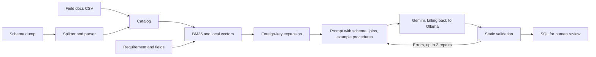

# Schema RAG

Generates SQL queries and stored procedures from natural-language requirements, grounded in a large database schema and your existing procedures. It supports MySQL and Oracle.

The tool **never executes SQL**. Developers review and run the output themselves.

**Status:** ingestion, retrieval, and static validation are tested on real schema dumps. LLM generation is implemented and tested against fake servers, but has not yet run against a real provider. See [the evaluation](docs/EVALUATION.md).

## How it works



Why these parts exist:

- **Foreign-key expansion:** a needed join table may sound unrelated to the request.
- **Composite-key-aware joins:** every column pair of a key stays together, so partial joins can be flagged.
- **Local embeddings:** schema text stays on your machine during indexing.
- **Static validation:** catches invented tables and columns without touching a database. It cannot catch valid SQL that returns wrong data.

## Setup

Requires Python 3.12 or later.

```bash
python3 -m venv .venv
.venv/bin/pip install -e '.[dev]'
cp config/databases.example.yaml config/databases.yaml
```

Edit `config/databases.yaml` to point at your dumps. On Debian or Ubuntu, `python3 -m venv` needs the `python3-venv` package.

## Usage

```bash
.venv/bin/schema-rag ingest mysql
.venv/bin/schema-rag retrieve mysql "overdue amount per customer" --fields "customer id,overdue amount"
.venv/bin/schema-rag generate query mysql "overdue amount per customer" --fields "customer id,overdue amount" --dry-run
.venv/bin/schema-rag validate query mysql my_query.sql
```

To generate SQL, set `GEMINI_API_KEY`, or install Ollama and use `--provider ollama`:

```bash
export GEMINI_API_KEY=your_key
.venv/bin/schema-rag generate procedure mysql "monthly overdue report by programme"
```

The tool asks before sending schema to a cloud provider. On the Gemini free tier, Google may use submitted content to improve its products, and human reviewers may read it. `--dry-run` shows exactly what would be sent. The first run downloads the embedding model (about 70 MB) and builds vectors, which takes about a minute on a laptop CPU.

## Field documentation

Point `field_docs_dir` at a folder with `columns.csv` and `glossary.csv`:

```text
columns.csv:  table_name,column_name,meaning,synonyms,values_or_format,caveats,evidence,confidence
glossary.csv: term,synonyms,definition,calculation_rule,related_columns,evidence,confidence
```

Leave `column_name` empty for a table-level row. Rows matching no real table or column appear in the ingestion report.

## Evaluation

```bash
.venv/bin/schema-rag eval-retrieval mysql --with-fields
.venv/bin/schema-rag eval-generation mysql --cases eval/questions.jsonl
```

Write your own questions using `eval/questions.example.jsonl` as a template. `eval-generation` writes a CSV with a blank `manual_correct` column to fill in after running the SQL yourself.

## Tests

```bash
.venv/bin/pytest
.venv/bin/ruff check .
```

Tests use made-up schemas and need no network or model download.

## Limitations

- Generation has not been evaluated against a real LLM.
- Validation is static, and much procedural code, especially dynamic SQL, cannot be checked.
- Retrieval rarely finds every table for complex reports. See the evaluation.
- No API, web UI, authentication, or Docker image.
- Oracle support expects a SQL Developer export, and Oracle functions and packages are skipped.

## Design decisions

See [the ADRs](docs/adr/).
